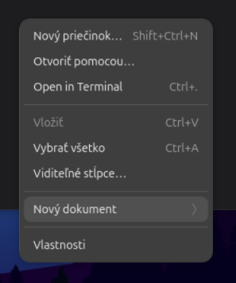
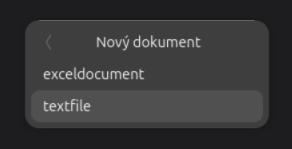
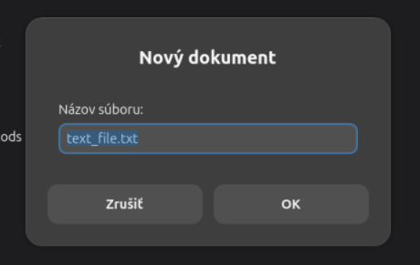

# NautilusNewFileFix

When you create a new file in **Nautilus** (GNOME Files, the default file manager
in Ubuntu's GNOME Shell), it gets a template name like `new_text_file.txt` and you
have to rename it afterwards. This package replaces the **New Document** submenu
with one that **asks for the file name first** and then creates the file.

## How it looks

Right-click empty space in a folder and open **New Document**:



Pick a template:



Type the name, and the file is created with it:



## Install

Download the `.deb` from `build/`, then:

```sh
sudo apt install ./build/nautilus-new-file-fix_1.2.0_all.deb
```

Files restarts by itself, and the new menu works right away. To uninstall:

```sh
sudo apt remove nautilus-new-named-document
```

Your original Templates folder is restored when you uninstall.

The menu lists the files in your Templates folder (`~/Templates`, `~/Šablóny`, …).
Sub-folders become submenus.

## Build from source

```sh
./build.sh
```

To see how it works and where to make changes, read [HOW-IT-WORKS.md](HOW-IT-WORKS.md).

## About

This was a one-day "vibe code" project, written with [Claude Code](https://claude.com/claude-code)
in October 2026. Project page: <https://kovo.space/en/projects/nautilus-new-file>

License: MIT
